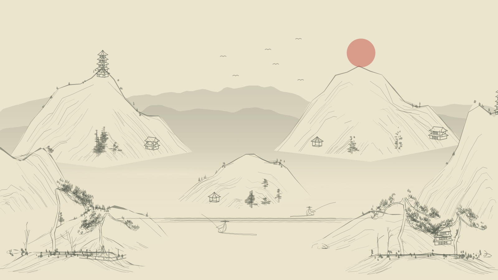
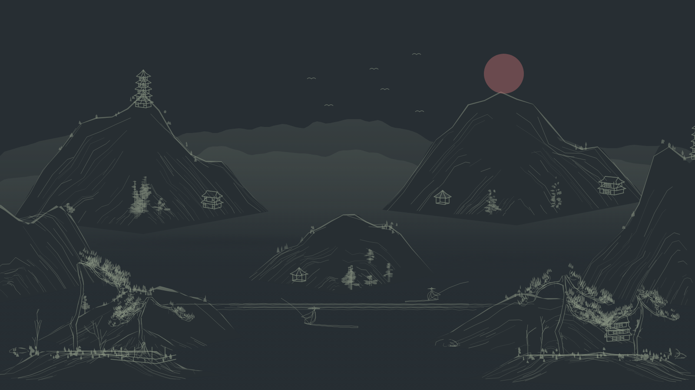

# Shan Shui Everforest

A look for Claude Desktop: an ink-wash mountain landscape in the style of [Shan Shui Inf](https://github.com/LingDong-/shan-shui-inf), painted in [Everforest](https://github.com/sainnhe/everforest)-style colors. Parchment and pine-ink by day, deep forest by night, with hatched mountains, pagodas, huts, boats, twisting pines and slowly drifting mist behind the chat. Text panels are slightly frosted so output stays readable.

## Preview

| Day | Night |
| --- | --- |
|  |  |

Static renders of the generated scene (the live version drifts and animates). SVG sources: `docs/scene-light.svg`, `docs/scene-dark.svg`.

## Install

```
/plugin marketplace add Theospe/shan-shui-everforest
/plugin install shan-shui-everforest@shan-shui-everforest
```

Or load a local copy with `claude --plugin-dir <this folder>`.

## Terminal theme

`terminal-theme.json` is a matching Claude Code terminal theme. Copy it to `~/.claude/themes/shan-shui-everforest.json` and set `"theme": "custom:shan-shui-everforest"` in `~/.claude/settings.json`.

## Customising

- Colors and glass blur/opacity: `hooks/register.tsx`.
- The scene is generated: `node generate-scene.mjs hooks/scene.ts <seed>` writes a new landscape (try a different seed number).

## Credits

The scene generator is a compact port of algorithms from Shan Shui Inf by Lingdong Huang (MIT License). `hooks/make-colors.js` is the color helper that ships with Claude's mod authoring skill.
